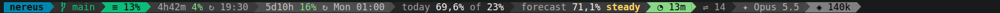

# The status bar

The bar under Claude Code's prompt shows, in one line, where the session is working, how full its context is and how much of the plan's quota is left.



```text
nereus  main  ≡ 13%  4h42m 4% ↻ 19:30  5d10h 16% ↻ Mon 01:00  today 69,6% of 23%  forecast 71,1% steady  ◔ 13m  ⇌ 14  ✦ Opus 5.5  ◈ 140k
```

## Each piece

| Piece | What it says | Colors |
|-------|--------------|--------|
| `⚠ pontos` | a raw log did not reach Drive (shown only then; run `pontos-save status`) | red |
| `nereus` | the repository, and the subfolder when there is one | blue |
| `main` | the branch and the git status | |
| `≡ 13%` | how full the context window is | green, yellow from 50%, red from 70% |
| `4h42m 4% ↻ 19:30` | the 5-hour limit: time left, usage, reset | green, amber from 50%, salmon from 80% |
| `5d10h 16% ↻ Mon 01:00` | the weekly limit: time left, usage, reset | same as above |
| `today 69,6% of 23%` | 23% is where the weekly usage should be by the end of today; 69,6% is how much of that goal it has reached (16 of 23) | white numbers |
| `forecast 71,1% steady` | the weekly usage at the reset if this pace goes on, and what to do about it | the word, below |
| `◔ 13m` | how long the session has been running | green, amber from 15 minutes, orange from 25, bordeaux from 35 |
| `⇌ 14` | the owner's messages in this session | |
| `✦ Opus 5.5` | the model | |
| `◈ 140k` | the session's tokens, input and output | |

`/rc`, on the right, is Claude Code's own: Remote Control is on.

## The forecast's word

```text
forecast = weekly usage × 7 days / time gone in the window
```

| Forecast | Word | What to do |
|----------|------|------------|
| below 70% | `push` (green) | speed up: more subagents and parallel sessions |
| from 70% to 95% | `steady` (amber) | keep the pace |
| above 95% | `slow` (salmon) | hold back: one agent, no subagents, or a day off |

The segment stays hidden in the first 6 hours of the window, while the forecast is unstable.

## Today's goal

The goal spreads what was left at the day's first reading evenly up to the reset, so it stays fixed all day. The share passes 100% once the goal is passed. A share above 100% does not mean the week is at risk: the forecast says that.

```console
$ claude-usage-plan
  Weekly quota: 16% used, resets Mon 09/11 01:00, target 100%
```

## Where it lives

The bar is the owner's own tooling, not part of Nereus: `scripts/bin/claude-status-line`, `claude-usage-plan` and `claude-usage-forecast` in the owner's dotfiles repository, set up by its `statusline-setup` skill.

To choose which limits appear:

```console
$ claude-status-line-limits --show weekly
```

`--show` takes `session`, `weekly`, `both` or `none`.
