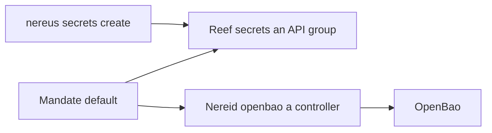

# Reef, Nereid and Mandate

A reef is a capability of the platform, a Nereid is the controller that looks after it, and a Mandate binds one reef to one Nereid.

## Example

`nereus --help` lists each reef installed with the Nereid that looks after it:

``` { .text .output title="output" }
Reefs:
  release         Reef release, looked after by nereid flux.
  secrets         Reef secrets, looked after by nereid openbao.
```

The secrets reef adds the kinds `Vault` and `Secret` and the commands `nereus secrets ...`; the Mandate `default` says that `openbao` keeps them.

## Picture



*The CLI speaks to the reef; the Mandate names the Nereid that does the work with its tool.*

## How it works

- A reef is an API group, `<reef>.getnereus.dev`, with its own kinds; [`nereus reef apply`](../specs/cli/core.html#reef-apply) adds one at runtime.
- A Nereid is a Kubernetes controller that reconciles the reef's objects and writes their `status`.
- A Mandate binds one reef to one Nereid; one Mandate per reef is the default, and its commands go there.
- Several Nereids can look after one reef (`keycloak` or `auth0` for authentication): you pick one per Mandate.
- Each reef adds its own commands to the CLI, so `nereus --help` grows with the installation.

## Not this

- A reef is not a Helm chart: it is the API; the Nereid brings the software behind it.
- A Nereid is not the tool itself: `openbao` is the controller, OpenBao is what it drives.

## Next

[Runtime install and profiles](runtime-and-profiles.md): how reefs and Nereids arrive in a running installation.
