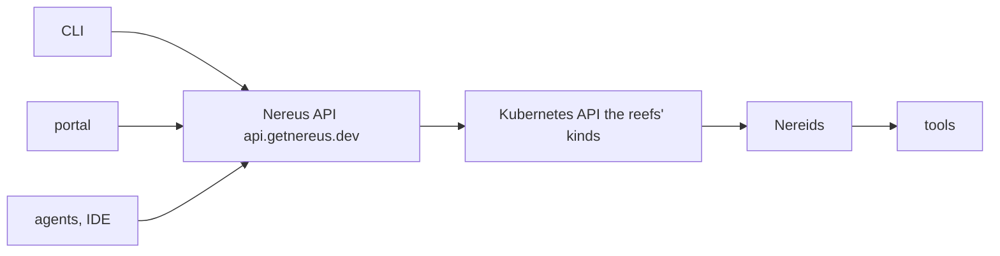

# The Nereus API

The Nereus API is the platform's one door: the CLI, the portal, an IDE and agents talk to it with the person's token, and the Kubernetes API, the Nereids and their tools stay behind it.

## Example

[`nereus whoami`](../specs/cli/reefs/authentication.html#whoami) asks the API's first route, `GET /v1/me`, instead of reading the local token:

```bash
nereus whoami --help
```

``` { .text .output title="output" }
Usage: nereus whoami [OPTIONS]

  Who you are, as the Nereus API answers (GET /v1/me) for the token of nereus
  login, never what the local token says: the login, and the User of Nereus
  behind it (#1645), or that there is none yet.
```

## Picture



*Clients hold a token, never a kubeconfig; what is behind the door stays behind it.*

## How it works

- It runs in the cluster as `nereus-api` in `nereus-system`, installed by `nereus init` with core; its public name is `api.<domain>`.
- It alone validates the token: the issuer and keys come from the authentication reef's default Mandate, the audience is `nereus-api`, and the Kubernetes apiserver never sees a person's token.
- It acts with its own identity, and decides what the person may do before acting ([Tenancy and access](tenancy-and-access.md)).
- It speaks of reefs and their kinds, never of tools, and reads what the Nereids publish in `status`; what it did not read, it says it did not.
- Command groups move behind it one at a time; the rest keep the kubeconfig as a stand-in, and the check `kubeconfig-ban` refuses any new use outside `nereus init` and the bootstrap.

## Not this

- Not the Kubernetes API: the reefs' kinds live there, but no client reaches it directly.
- Not a proxy to each tool's API: no route names Flux, Keycloak or OpenBao.
- Not the portal: the portal is one client of the API, as the CLI is.

## Next

[Install the CLI](../start/install.md): try it on your own machine.
