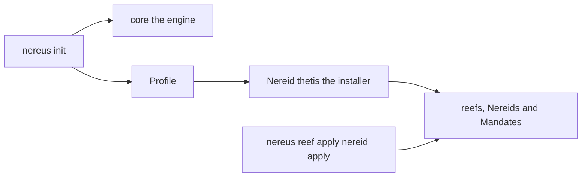

# Runtime install and profiles

Nereus installs its capabilities at runtime: `nereus init` lays down the engine, `core`, and a profile is a named list of reefs, Nereids and Mandates applied on top of it.

## Example

[`nereus profile describe`](../specs/cli/core.html#profile-describe) shows what a profile installs, in order, each Nereid with its reef and its Mandate:

```bash
nereus profile describe secrets
```

``` { .text .output title="output" }
NEREID   REEF     MANDATE            REQUIRED BY
openbao  secrets  default (default)  -
```

## Picture



*Init lays down core; a profile, or a person one command at a time, adds the rest.*

## How it works

- [`nereus init`](../specs/cli/core.html#init) installs the kinds, the namespace, the Nereus API, core and the tenancy reef with Helm; the profile `core`, the default, installs nothing more.
- [`nereus init --profile internal-developer-platform`](../specs/cli/core.html#init-profile) adds a profile: the Nereid `thetis` installs its reefs, Nereids and Mandates, and `init` waits until they are Ready.
- A profile never writes the order: each Nereid comes after the Nereids of the reefs it requires, read from its image's label `core.getnereus.dev/requires`.
- A profile adds nothing the commands cannot do: `nereus reef apply`, `nereus nereid apply` and `nereus mandate create` do the same by hand, on a running installation.
- A profile never carries a secret: credentials reach a Nereid through the secrets reef, encrypted on the client, once the profile is installed.

## Not this

- Not a fixed install: reefs and Nereids come and go on a running installation, and init never has to run again for them.
- Not a size: profiles are named by purpose, never `minimal` or `full`; `core` alone is the default, so a plain init stays fast.
- Not access: who may do what is a role, in [Tenancy and access](tenancy-and-access.md).

## Next

[Undercloud and overcloud](undercloud-overcloud.md): where an installation starts when its home is a cloud.
