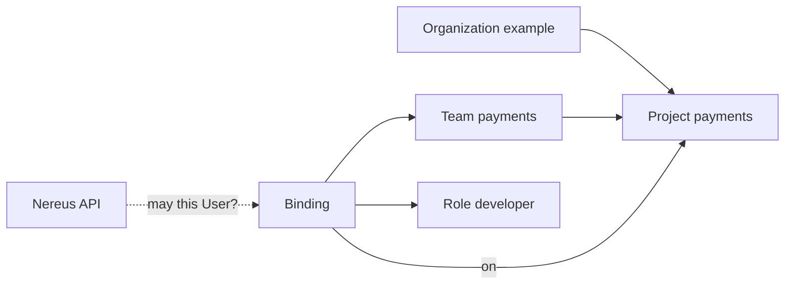

# Tenancy and access

Tenancy says whose each thing is, a tree of Organizations and nested Projects; access says who may do what on a node of that tree, through roles bound to teams.

## Example

The tree is two kinds of the tenancy reef, applied with [`nereus tenancy apply`](../specs/cli/reefs/tenancy.html#apply):

```yaml
apiVersion: tenancy.getnereus.dev/v1alpha1
kind: Organization
metadata:
  name: example
---
apiVersion: tenancy.getnereus.dev/v1alpha1
kind: Project
metadata:
  name: payments
spec:
  parent: {kind: Organization, name: example}
```

## Picture



*A binding gives a role to a team on one node; the API asks before it acts.*

## How it works

- Tenancy is a reef, `tenancy.getnereus.dev`, whose kinds come from each instance: every kind is a node with an optional `spec.parent`, and one kind, the boundary, isolates people and billing (here `Organization`).
- Whatever belongs somewhere names `owner: {kind, name}` in the tree: a Workload, an Environment, a team.
- The `authorization` reef holds access: a `Role` is a list of rules, `<reef>:<kinds>:<verbs>`, and a `Binding` gives it to a team, a position in a team or, as the exception, one User, on one node; access flows down the tree.
- The `teams` reef keeps one list of members: joining a team grants its access, leaving removes it. A person is one core `User` whatever the login, and a login with no User has no permission.
- The Nereus API asks before it acts; [`nereus can-i`](../specs/cli/reefs/authorization.html#can-i-yes) asks the same question and names the binding that grants it.

## Not this

- A Project is not a Kubernetes namespace: it nests, and one Project runs in several environments, on several clusters.
- A team is not an identity provider's group: groups are an output a Nereid may write, never the source.
- A role is not a profile: a [profile](runtime-and-profiles.md) is what an installation installs.

## Next

[The Nereus API](nereus-api.md): the door every client goes through.
