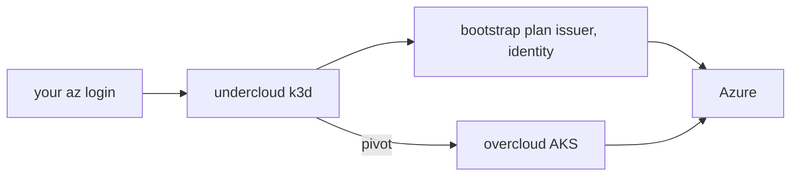

# Undercloud and overcloud

The undercloud is the local k3d cluster that seeds an installation and bootstraps its cloud; the overcloud is the cloud cluster, AKS first, the platform then moves into, still as one installation.

[planned #61]

## Example

A cloud in the settings file makes `nereus init` create the undercloud, `tailwind-undercloud`, instead of a plain local cluster:

```yaml
apiVersion: core.getnereus.dev/v1alpha1
kind: InitConfig
spec:
  cloud: azure
---
apiVersion: core.getnereus.dev/v1alpha1
kind: Installation
metadata:
  name: tailwind
spec:
  alias: tailwind
```

## Picture



*The undercloud gets the cloud to trust it, then hands the platform to the overcloud.*

## How it works

- [`nereus init --target azure`](../specs/cli/core.html#init-target) computes the cluster's OIDC issuer from the installation's id before the cluster exists, then installs the `cloud` reef and its `azure` Nereid.
- The Nereid plans the bootstrap (the names, the issuer storage, the issuer documents, the first identity); the CLI shows the plan and runs it with your own login once you approve.
- From then on the cloud trusts the cluster's tokens through workload identity federation, so the platform keeps no secret.
- The pivot moves the platform to the overcloud, as Cluster API's `clusterctl move` does, moves the federated credential to the overcloud's issuer, then deletes the undercloud [planned #61].
- Both are one installation: the same name, id and identities; only the cluster role label, `core.getnereus.dev/cluster-role`, stays with each cluster.

## Not this

- Not two installations, nor staging and production: one platform on two clusters, one after the other.
- Not a management cluster kept forever: the undercloud is deleted after the pivot.
- Not needed on a laptop: a plain `nereus init` with no cloud makes a cluster named `nereus`, with no undercloud role.

## Next

[Tenancy and access](tenancy-and-access.md): whose each thing is, and who may do what.
