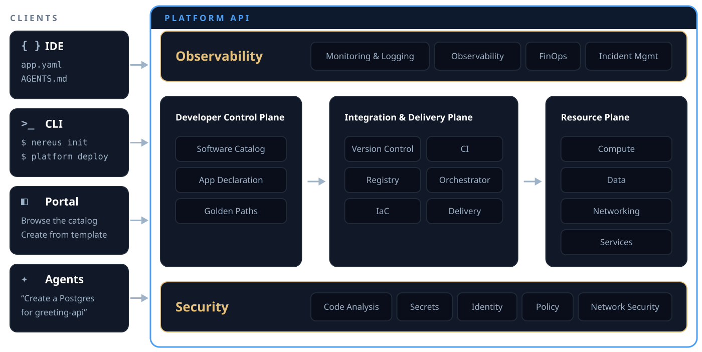

# Where it is heading

The Nereus API is the one door for every client: the CLI, a portal, an IDE reading an `app.yaml`, an agent asked to "create a Postgres for greeting-api". None needs a kubeconfig, and all speak of reefs, not of the tools behind them (ADR 0002).

An Internal Developer Platform is one profile of it: a platform serves any recurring knowledge work, as the "internal marketing platform" and the "patient tracking platform" of *Thinking in Platforms* do (Kaspar von Grünberg and Luca Galante, p. 20; [Thinking in platforms](thinking-in-platforms.md)).

Each box in a plane is a candidate reef: **Delivery** is `release` (ADR 0010), **Identity** is authentication (ADR 0006), **Data** would be `database`. A reef arrives at runtime with its contract, and the Nereids added to it fill the box (ADR 0003, ADR 0010).

What the API adds over the Kubernetes API each reef already extends:

- **Composition.** An app declaration or a golden path becomes several Instances at once: a release, a database, an identity.
- **What crosses the planes.** Authentication, authorization by team, policy, cost and several clusters belong to the platform, not to one reef or cluster.
- **Moving parts from day one.** Platform teams pick tools from the [CNCF Landscape](https://landscape.cncf.io/) and soon have code depending on each choice. Here a team tries a tool as a Nereid and, if it does not fit, adds another to the same reef and switches its default Mandate, with no command, client or app declaration to change (ADR 0002, ADR 0011).

What runs today: [What is built](reference/what-is-built.md); what comes next and the ideas being refined: [Roadmap](project/roadmap.md). The vision, goals and sequence of the MVP: [Inception](project/inception.md).

## What guides the work

"Nothing new under the sun, except the AI agents" (the owner, 2026-11-03): the practices here are old ones (Agile, XP, flow, WIP limits), and what is new is who carries them out.

The project calls these pillars so that it orients itself by them, and so that its agents understand what the project's people value (the owner, for now) and come to value it too. That lets an agent collaborate better and register ideas during its own work. Their number is not a problem: the agents help remember them (the owner, 2026-11-03).

This page holds the one full list; other pages point to it or highlight part of it.

Twenty-five pillars, in the owner's words:

- the Agile Manifesto
- Extreme Programming, adjusted to AI agents
- short cycles and frequent deliveries
- continuous learning and improvement
- costs as a lever
- open source first
- deterministic first, AI only where it is good
- transparency
- metrics and real users decide
- every interaction tells the story
- a platform progressively extensible in its capabilities
- every fix gets an issue
- eat your own dog food
- issues an agent can carry out alone
- every commit follows Conventional Commits
- courtesy and respect with everyone
- security from the first slice
- no personal data in a command or a log (a direction until there is an audit trail)
- credit what we use
- the Nereus API is the one door, and it cannot lie
- the same quality for fewer tokens
- simple on the surface, consistent underneath
- whatever the CLI reaches, MCP reaches
- no single control point
- an experience that works becomes an exploration of a possible feature

Where a pillar is a known technique, it names its source and links it.

### The Agile Manifesto

Follow the [Manifesto for Agile Software Development](https://agilemanifesto.org/), above all **working software over comprehensive documentation** and **working software is the primary measure of progress**. So every slice ends with a scene a person runs from the CLI, the walkthrough shows the output commands really print, and progress is measured by what runs (#57), not by what was written. Documentation follows the software.

Learn more: the [Manifesto](https://agilemanifesto.org/) (2001) and its [twelve principles](https://agilemanifesto.org/principles.html), where "working software is the primary measure of progress" is the seventh.

### Extreme Programming, adjusted to AI agents

**Extreme Programming, adjusted to work with AI agents**: Kent Beck's Extreme Programming (XP), from *Extreme Programming Explained* (1999), in small steps that each end in working software. With an agent on one side of the pair:

- **Small releases and continuous integration:** one issue per deliverable, one pull request each, checked with the scene on k3d before it merges.
- **Test-first and the scene:** each slice starts from the scene a person will run; tests and checks run on every change, for people and agents alike. With an agent, test-first is kept at the level of behaviour: the contract (the scene, the CLI examples, a test of the behaviour) comes first and is seen failing; the red-green-refactor micro-cycle on every small step is optional ([the rule](agent/rules.md), #1153).
- **Pair programming:** agents implement in parallel, a coordinating agent reviews and merges, and the owner decides what the issue does not hold, one question at a time.
- **The planning game:** the board's order is the plan; the owner reprioritizes it, and forecasts come from what was delivered (#95), not from estimates.
- **Collective ownership and simple design:** every rule lives in the repository (`CLAUDE.md`, ADRs, specs, skills); anything learnt goes back there, in the same session.

Agent contribution and the XP practices that fit this era: #40; recording and telling the experience: #113.

Learn more: Martin Fowler's [summary of Extreme Programming](https://martinfowler.com/bliki/ExtremeProgramming.html); Don Wells's [extremeprogramming.org](http://www.extremeprogramming.org/), with its rules on [small releases](http://www.extremeprogramming.org/rules/releaseoften.html), [pair programming](http://www.extremeprogramming.org/rules/pair.html) and [the planning game](http://www.extremeprogramming.org/rules/planninggame.html); Martin Fowler's [Continuous Integration](https://martinfowler.com/articles/continuousIntegration.html). How well the practices work with an agent as one side of the pair is the project's own observation, measured in #113.

### Short cycles, frequent deliveries

Each cycle ends in something delivered: an issue small enough to close in hours, a pull request merged once the checks and the review pass, `main` always working.

The checks run locally for now: GitHub Actions is off to save its cost, and CI will run inside the platform itself, on BuildKit (#848, the build reef). A long branch, a big pull request or an issue `In Progress` for days means cut again. Flow metrics (#95) show whether the cycles stay short. Good enough now, improve later: ship the thinnest slice that works end to end, then widen it.

Learn more: each slice starts as a [walking skeleton](https://wiki.c2.com/?WalkingSkeleton) (Alistair Cockburn): "a tiny implementation of the system that performs a small end-to-end function", widened afterwards. The flow metrics (cycle time, work item age, throughput) are those of [The Kanban Guide](https://kanbanguides.org/).

### Continuous learning and improvement

Every attempt, even a dropped idea, leaves what it taught: an issue (improvement, feature, bug), a rule or decision in the repository (`CLAUDE.md`, an ADR, a spec, a skill, the glossary), or a measurement: agent runs (#113), forecasts against delivery (#95), software quality (#102). A discarded idea closes with its lesson on its issue. What is learnt then changes how the work happens: the way of working is itself reviewed and reorganized, as this list of pillars was (#871).

Learn more: "A platform that doesn't evolve is not a platform, it's an imposed process", and "the objective isn't to perfect the plan, but to tighten the learning loop" (Kaspar von Grünberg and Luca Galante, *Thinking in Platforms*, p. 59 and p. 31; [Thinking in platforms](thinking-in-platforms.md)).

### Open source first

Before building, look for an open source tool or a native resource that already does it, and integrate it with the model of reefs and Nereids. Build only when none fits, and the issue says which ones were evaluated and why each falls short. Time, tokens and money are not spent rebuilding what a tool already does.

### Deterministic first, AI only where it is good

Plain code, rules and checks where they do the job; Artificial Intelligence (AI) only where it does better, such as a summary, a classification or an extraction. A first version may be an agent following a rule; it then evolves into a script, a hook, a test or a check that does the same every time.

When a rule depends on an agent remembering it, propose what enforces it: `scripts/board/queue claim` refuses an item someone else holds, and `claude-guard-main-clone` refuses a change in a main clone.

A check that starts with exceptions keeps them in a ratchet (the owner, 2026-11-16): an allowlist of what exists today, which only shrinks, so a fix lowers it in the same change and nothing new joins it; `make kubeconfig-ban` (#1529) is the first, the personal-data check (#1680) the next, which warns and never blocks until Nereus has an audit trail. Learn more: [Ratchets in software development](https://qntm.org/ratchet) (qntm, 2021).

### Transparency

Decisions, designs and the way the work happens are written in the repository: the ADRs (Architecture Decision Records), the specs, the agent guides and the issues.

### Metrics and real users decide

A feature lives or dies by what it measures and by its users, not by opinion.

Learn more: a platform is "operated and observed, then refined based on user feedback", with "close interaction with users to set abstractions correctly" (*Thinking in Platforms*, p. 26 and p. 57; [Thinking in platforms](thinking-in-platforms.md)).

### Costs as a lever

Every cost is measured (#56, #57, #113), but not everything must be solved at no cost. When a measured bottleneck costs more in time or quality than the money that removes it (a higher AI plan when usage limits stall the work, a paid service when a free one blocks a decision), the spend is made and recorded with what triggered it. The figures live in the private repository (#31); this one keeps only the method.

### Every interaction tells the story

Every exchange, person and agent, agent and agent, is a chance to tell how the project evolves: the question that changed a design, the failure CI caught, the limit that stopped an agent. The story is kept as it happens: decisions on their issues, moments and figures in the log of #113 (figures in the private repository), the panel's rounds, the board's metrics.

It feeds the talks, the deck and the courses (#33), and the platform's Inception (#24): the platform will record and tell its own construction.

### Progressively extensible

The platform grows its capabilities step by step. `nereus init` only prepares a cluster; every capability is a reef added at runtime and looked after by a Nereid (ADR 0002, ADR 0011), each adding its own commands to the CLI. A new capability (secrets, authentication, cost, a portal) is one more reef, not a new release of the core. The skills, metrics and rules of the project grow the same way.

Learn more: Kubernetes grows the same way, its API extended by [custom resources and the operator pattern](https://kubernetes.io/docs/concepts/extend-kubernetes/operator/); the split of a contract from what fulfils it follows [Gateway API's `GatewayClass`](https://gateway-api.sigs.k8s.io/reference/api-types/gatewayclass/) and [Crossplane's composite resource definitions](https://docs.crossplane.io/latest/composition/composite-resource-definitions/) (ADR 0010, reefs are objects added at runtime). Once primitives "are stable, reusable, and connected through clear rules, variation no longer has to be rebuilt from scratch each time" (*Thinking in Platforms*, p. 63; [Thinking in platforms](thinking-in-platforms.md)).

### Every fix gets an issue

Every fix, even a small one, gets its own issue, and the pull request that makes it closes it. A fix found mid-task opens its `bug` issue first, so the metrics count every fix: the queue's flow (#95), software quality (#102), the agents' work (#113): how often things break, how fast they are fixed, what kept breaking.

### Eat your own dog food

The platform is used to build itself. Each capability the project needs (an always-on environment deployed continuously, #159; its metrics, #113; its board, #137) becomes a capability of the platform as soon as it can, and the project is its first user. Until the platform does it, plain files and scripts do, and are replaced. Until a running Nereus receives them, every session records its metrics in the private repository (#31). This is the Inception of #24 made a habit.

Learn more: [eating your own dog food](https://en.wikipedia.org/wiki/Eating_your_own_dog_food).

### Issues an agent can carry out alone

Every issue lets an agent take it from the board and deliver it without more confirmation. It holds:

- its context
- the decisions taken (who, when)
- the dependencies and what they deliver
- the facts checked in the code
- the names a person will see or type
- a "Done when" the agent can check itself

An open question that changes what a person sees is answered before the issue is ready, or the issue says which recommendation to follow. Questions to the owner are for what the issue cannot hold. This is the Definition of Ready that autonomous agents (#25) will need.

### Every commit follows Conventional Commits

Every commit follows [Conventional Commits](https://www.conventionalcommits.org/en/v1.0.0/), no exception: `<type>(<scope>)!: <description>`, the type one of `feat`, `fix`, `docs`, `chore`, `refactor`, `test`, `ci`, `build`, `perf`, `style`, `revert`, `bump`.

The history is data: [Commitizen](https://commitizen-tools.github.io/commitizen/) (`cz.yaml`) derives the versions from it, starting at 0.1.0 (#55), and the metrics read it: fixes against features (#102), what each agent run delivered (#113), whether every fix had its issue.

`.githooks/commit-msg` refuses a message outside the format (`make hooks`), and CI checks every commit of a pull request with `scripts/check-commit-message`, both through `cz check`.

### Courtesy and respect with everyone

Every exchange is courteous and respectful, between people, agents, and both, in issues, comments, reviews, pull requests, commit messages, the panel's rounds and reports. Disagreement goes to the idea, never to the person; a review names what to change and why; a question is answered, or said plainly that it cannot be yet. Agents follow it as people do. A code of conduct for contributors comes with going public (#9).

### Security from the first slice

Security is designed in from a feature's first slice. Auditing, authorisation and secrets handling are provided for in the architecture: every action in a cloud says which identity, which Nereid and on whose request it ran (spec 0005).

The baseline is OWASP's (#237): every spec's security section names the categories its slice touches and what covers each, and what is designed or built is reviewed against them (#235), so a gap is an issue, not a rewrite. The project prepares for the regulations its users answer to, SOX, the GDPR and the LGPD, with DevSecOps in its own delivery (#238).

### No personal data in a command or a log

A command should not take personal data, and a log should not record it (the owner, 2026-11-16). A person is named by a Nereus object, a `User` or a team, by its name or id, never by an e-mail, a phone number or a document: what a person types lands in the shell's history, the API's access log, the audit trail and the object itself, and none of them can be cleaned later.

It is a direction, not yet a hard rule: Nereus has no audit trail yet, so the check that follows it (#1680) keeps its ratchet but only warns, never blocks a change (the owner, 2026-11-16); it blocks once the audit trail exists. The design to follow meanwhile: a person named by a `User` or a team, an invite that carries the e-mail in the request body (#1679), a list read from a file or a Secret (#1686).

The staff of a talk is a team of Users named once, not a list of e-mails on the command line (#218).

The personal data a feature needs (an e-mail to deliver a prize, a sign-up) is entered on a form that sends it in the request body, kept in one place the person can delete, and referred to everywhere else by an opaque id; what stays after a deletion is anonymized. Learn more: OWASP lists personal data among the [data to exclude from logs](https://cheatsheetseries.owasp.org/cheatsheets/Logging_Cheat_Sheet.html) (Logging Cheat Sheet); the LGPD and the GDPR ask for data minimisation.

### The Nereus API is the one door, and it cannot lie

The Nereus API is the single point of communication between the platform and the outside world: the CLI, the portal, an IDE and the agents talk to it, and what is behind it stays behind it (ADR 0018). A new command reaches the cluster through it, never through a kube context; the commands not yet moved keep the kubeconfig, a stand-in ADR 0018 names and ends one command group at a time.

The name says why: Nereus knows everything and cannot lie, in the owner's words, and Hesiod's *Theogony* (233 ff.) calls him ["truthful Nereus who tells no lies"](https://www.theoi.com/Pontios/Nereus.html). So the API answers what it read, and what it did not read it says it did not: `nereus doctor` (#799) shows a check that did not run as `skipped`, never `pass`, and a person with no login gets a shorter answer, never a different one.

Learn more: without a platform, "work crosses the boundary through ad hoc negotiation rather than through a well-designed interface"; the answer is to "replace negotiation with paths" (*Thinking in Platforms*, p. 60 and p. 62; [Thinking in platforms](thinking-in-platforms.md)).

### The same quality for fewer tokens

Before an activity, an agent weighs whether the way it plans to do it could reach the same quality for less: a smaller answer, fewer subagents or a narrower brief, a lighter model for mechanical work, a script instead of an agent. It does the cheaper way, or suggests it when the choice is the owner's. Quality comes first: a saving that brings rework is no saving. `scripts/metrics/order` (#803) measures it per order and agent.

### Simple on the surface, consistent underneath

What a person types first is the familiar, welcoming form; what it reaches underneath behaves like everything else in the platform. The root form `nereus invitation create` is the familiar one, and underneath the invitation is a kind of the `authentication` reef, with the same verbs, output and errors as every other noun (spec 0007, ADR 0013).

Learn more: "Standardization is a compounding floor, not a ceiling on what is possible" (*Thinking in Platforms*, p. 59; [Thinking in platforms](thinking-in-platforms.md)).

### Whatever the CLI reaches, MCP reaches

Everything a person can do from the CLI, an agent can do as that person through the MCP server of the Nereus API (`nereus mcp`, ADR 0029). Parity is of capability, not of commands: a few generic tools read every kind of every reef, and each reef declares the tools for what people come to it to do. A tool is designed for a goal, never generated from a command or a route (owner, 2026-11-26).

Deterministic first: a check, `mcp-coverage` (#2294 for reads, #2295 for writes), proves that every kind is reachable and that every command that changes something is covered by a tool, kept CLI-only with a reason, or listed in a ratchet that only shrinks. It proves someone decided; the tool's design stays a judgement.

Learn more: [Writing effective tools for AI agents](https://www.anthropic.com/engineering/writing-tools-for-agents) (Anthropic, 2025): consolidate into goal-shaped tools instead of wrapping endpoints.

### An experience that works becomes an exploration of a possible feature

When something done by hand works, the project asks whether it could be a Nereus feature, and records the exploration as an issue, with what happened and what it taught. It is an exploration, not a commitment: the owner's triage decides whether it goes on. Coordinating six sessions by hand to bring their work to `main` became #956 (an agents' merge queue in Triton).

### No single control point

Control (identity, authorization, quota, policy) is enforced in layers: the cloud, Kubernetes, the Environment and the Nereus API. One layer failing or misconfigured must not collapse the platform, and no one layer is the only place a rule lives.

What holds today: the Nereus API checks every request against the person's roles and bindings, and fails closed when its authorization store is down; the `nereus-admins` group is the emergency exit, which does not depend on that store, and `nereus doctor` warns when it was used (spec 0011, #1644). What does not yet: Kubernetes RBAC derived from the bindings, and cloud policy, so today the Nereus API is still the one layer that enforces them.

Learn more: a platform should not make one component the single place where control is held (*Thinking in Platforms*, Kaspar von Grünberg and Luca Galante, 2026; [Thinking in platforms](thinking-in-platforms.md)).

### Credit what we use

Every technique, practice or pattern the docs use is named, credited and linked, with what the project takes from it, in the style of evidence-based medicine (the owner, #332):

- an ADR has a `## Prior art` section before its Consequences (ADR 0012, every error message says what happened and how to fix it, is the first)
- a spec or a page has a "Learn more" line
- this page names the source of each pillar that is a known technique

A claim of effect cites its evidence (a study, a book, a measurement) or says it is the project's own observation. Every link is opened before it is cited, and no author or year is guessed. The deck does the same (`docs/presentations/references/`, #202).

An agent that notices a technique, practice or study that could improve the product, code or process opens a `Proposal` issue with `proposed-by-agent`: the technique named and credited, links, evidence, where it applies here and a recommendation. It never adopts it on its own: the owner decides whether, when and how.

## How every feature is born

A principle being refined ([#28](https://github.com/getnereus/nereus/issues/28)) for every feature:

- **Security and the quality attributes from the start.** Every idea is discussed under security, the other "-ilities" and their fitness functions before it is built.
- **Alpha, beta, stable.** Alpha is a proof of concept that never reaches production; beta works and has the minimum to be presented; stable comes after it ran, was tested and collected metrics, preferably from real users.
- **Early adopters.** A feature can go to a chosen group of users first.
- **Edge and stable channels.** Everything merged to `main` is deployed to an edge environment where every test runs (smoke, performance, penetration); only graduated features are promoted to stable.

The `helm` Nereid ([#8](https://github.com/getnereus/nereus/issues/8)) is the first to go through it, as alpha.
